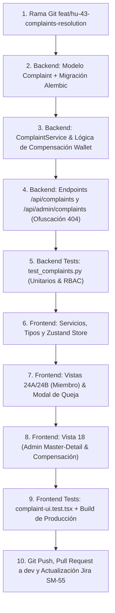

# Plan de Implementación: SM-55 / HU-43 — Centro de Quejas, Resolución de Disputas y Compensación en Puntos

> **Documento de Diseño Técnico y Planificación Operativa (ODD)**  
> **Historia Jira:** [SM-55](https://sauterdevs.atlassian.net/browse/SM-55)  
> **Épica:** `EPIC-12: Economía de Puntos, Billetera y Resolución de Quejas` (SM-12)  
> **Requisitos Funcionales Asociados:** `RF-GOV-01`, `RF-GOV-02`, `RF-GOV-03`  
> **Rama de Trabajo:** `feat/hu-43-complaints-resolution` (con destino a `dev`)

---

## 1. Visión y Alcance del Requerimiento

### 1.1 Objetivo del Negocio
Proveer un canal formal, auditable y transparente para que cualquier miembro (`UserRole.MEMBER`) que haya experimentado inconvenientes en una sesión de mentoría o en la plataforma pueda radicar una queja documentada con motivos y evidencias. Al mismo tiempo, otorgar al Administrador (`UserRole.ADMIN`) una consola arbitral integral (*Master-Detail*) para revisar el caso, emitir una respuesta oficial vinculante, cerrar la disputa (`RESOLVED` o `DISMISSED`) y, si lo considera meritorio, compensar al usuario con SkillPoints (SP) mediante acreditación bancaria inmediata en su billetera (`ADMIN_REWARD`).

### 1.2 Reglas de Gobernanza y Principios Rectores
1. **Política de Ofuscación 404 (Security by Obfuscation):** Cualquier intento de acceso no autorizado por un `MEMBER` o visitante anónimo a las rutas de administración (`/admin/complaints` o endpoints `/api/admin/complaints/...`) debe retornar **`statuscode: 404` ("Recurso no encontrado")**, jamás un `403 Forbidden`. La existencia del panel debe permanecer oculta a los usuarios comunes.
2. **Cero LLMs Externos:** La resolución y arbitraje es 100% determinística y humana (ejecutada por un administrador del sistema), respetando estrictamente la política del proyecto.
3. **Contrato Estándar `APIResponse`:** Todas las respuestas del backend siguen `{ statuscode, message, data, count }`.
4. **Integración con Billetera (HU-42):** Si el administrador decide compensar con puntos, la acreditación interactúa directamente con el servicio contable `wallet_service`, incrementando el saldo y generando un registro inmutable en `point_transactions` con tipo `ADMIN_REWARD`.
5. **Notificaciones Multicanal:** Se disparan notificaciones Web Push, in-app en la campana y vibración háptica móvil al resolverse la queja.

---

## 2. Mapa de Vistas UI (Prototipos Oficiales)

| Código Vista | Tipo Pantalla | Archivo Prototipo | Propósito en el Flujo |
| :--- | :--- | :--- | :--- |
| **24A** | Desktop Web | `24a-centro-de-quejas-y-soporte-al-usuario.png` | Bandeja de quejas del miembro (`/complaints`), filtros por estado, respuestas oficiales y badges. |
| **24B** | Desktop Web | `24b-formulario-de-apertura-de-queja-pruebas.png` | Formulario de denuncia: categoría, selector opcional de sesión, descripción y pruebas. |
| **18** | Desktop Web | `18-centro-de-quejas-resolucion-de-disputas-compensacion.png` | Consola Master-Detail de arbitraje admin (`/admin/complaints`) con editor de resolución y switch de compensación SP. |
| **26A** | Mobile | `26a-mobile-centro-de-quejas-usuario.png` | Vista móvil responsive del historial de quejas del usuario. |
| **26B** | Mobile | `26b-mobile-formulario-de-queja-pruebas.png` | Modal/pantalla móvil táctil para radicación de reclamo. |
| **20** | Mobile | `20-mobile-centro-de-quejas-disputas.png` | Consola móvil para moderación y arbitraje administrativo. |

---

## 3. Arquitectura de Backend (FastAPI + SQLAlchemy 2.0 + Alembic)

### 3.1 Modelo de Datos: `Complaint` (`backend/app/models/complaint.py`)
```python
class ComplaintStatus(str, enum.Enum):
    OPEN = "OPEN"
    RESOLVED = "RESOLVED"
    DISMISSED = "DISMISSED"

class ComplaintReason(str, enum.Enum):
    NO_SHOW = "NO_SHOW"                         # Instructor/alumno no se presentó
    INAPPROPRIATE_BEHAVIOR = "INAPPROPRIATE"    # Lenguaje o conducta inapropiada
    TECHNICAL_FAILURE = "TECHNICAL_FAILURE"      # Fallas de audio/video o plataforma
    QUALITY_ISSUE = "QUALITY_ISSUE"              # Contenido no acorde a lo acordado
    PAYMENT_DISPUTE = "PAYMENT_DISPUTE"          # Disputa por puntos retenidos/escrow
    OTHER = "OTHER"                              # Otros motivos generales

class Complaint(Base):
    __tablename__ = "complaints"

    id: Mapped[UUID] = mapped_column(primary_key=True, default=uuid4)
    user_id: Mapped[UUID] = mapped_column(ForeignKey("users.id", ondelete="CASCADE"), nullable=False, index=True)
    session_id: Mapped[Optional[UUID]] = mapped_column(ForeignKey("exchange_sessions.id", ondelete="SET NULL"), nullable=True, index=True)
    
    reason: Mapped[str] = mapped_column(String(50), nullable=False)
    title: Mapped[str] = mapped_column(String(150), nullable=False)
    description: Mapped[str] = mapped_column(Text, nullable=False)
    evidence_urls: Mapped[Optional[List[str]]] = mapped_column(JSONB, nullable=True, default=list)
    
    status: Mapped[str] = mapped_column(String(20), default=ComplaintStatus.OPEN.value, index=True, nullable=False)
    
    # Campos de resolución administrativa
    admin_response: Mapped[Optional[str]] = mapped_column(Text, nullable=True)
    points_compensated: Mapped[int] = mapped_column(Integer, default=0, nullable=False)
    resolved_by_id: Mapped[Optional[UUID]] = mapped_column(ForeignKey("users.id", ondelete="SET NULL"), nullable=True)
    resolved_at: Mapped[Optional[datetime]] = mapped_column(DateTime(timezone=True), nullable=True)

    created_at: Mapped[datetime] = mapped_column(DateTime(timezone=True), default=lambda: datetime.now(timezone.utc), nullable=False)
    updated_at: Mapped[datetime] = mapped_column(DateTime(timezone=True), default=lambda: datetime.now(timezone.utc), onupdate=lambda: datetime.now(timezone.utc), nullable=False)

    # Relaciones
    user: Mapped["User"] = relationship("User", foreign_keys=[user_id], lazy="selectin")
    session: Mapped[Optional["ExchangeSession"]] = relationship("ExchangeSession", lazy="selectin")
    resolved_by: Mapped[Optional["User"]] = relationship("User", foreign_keys=[resolved_by_id], lazy="selectin")
```

### 3.2 Esquemas Pydantic (`backend/app/schemas/complaint.py`)
- `ComplaintCreateRequest`: `title`, `reason`, `description`, `session_id` (opcional), `evidence_urls` (opcional).
- `ComplaintResolveRequest`: `status` (`RESOLVED` o `DISMISSED`), `admin_response` (mínimo 10 caracteres), `points_to_compensate` (entero `>= 0`, default `0`).
- `ComplaintResponse`: Payload completo de la queja incluyendo datos del usuario solicitante, detalles de la sesión vinculada, respuesta del admin, puntos compensados y timestamps.
- `ComplaintFilterParams`: `status` (`OPEN`, `RESOLVED`, `DISMISSED`, `ALL`), `page`, `page_size`.

### 3.3 Servicio de Dominio: `ComplaintService` (`backend/app/services/complaint_service.py`)
- `create_complaint(db, user_id, payload)`:
  - Valida que si se proporciona `session_id`, la sesión exista y el usuario sea participante de ella.
  - Crea el registro de queja en estado `OPEN`.
  - Emite notificación in-app de confirmación de recepción.
- `get_user_complaints(db, user_id, page, page_size)`:
  - Recupera las quejas del usuario autenticado ordenadas por `created_at DESC` con conteo total.
- `get_admin_complaints(db, status_filter, page, page_size)`:
  - Recupera todas las quejas del sistema para el panel administrativo, soportando filtros por estado.
- `resolve_complaint(db, admin_user, complaint_id, payload)`:
  - Verifica que la queja exista y esté en estado `OPEN` (o actualiza resolución).
  - Si `points_to_compensate > 0`:
    - Incrementa el saldo de la billetera del usuario afectado mediante `wallet_service.get_or_create_wallet`.
    - Inserta transacción contable inmutable `PointTransaction` con `transaction_type = 'ADMIN_REWARD'`, monto `+points`, y descripción detallando el número de queja.
  - Actualiza `admin_response`, `status`, `resolved_by_id`, `resolved_at` y `points_compensated`.
  - Emite notificación en tiempo real al usuario: *"Tu queja fue resuelta. Se acreditaron +X SP como compensación"*.

### 3.4 Controladores y Routers (`/api/complaints` y `/api/admin/complaints`)
1. **Router Miembro (`backend/app/api/complaints/router.py`)**:
   - `POST /api/complaints`: Radicar reclamo.
   - `GET /api/complaints/my`: Consultar mis quejas con historial y resoluciones.
2. **Router Administrador (`backend/app/api/admin/complaints/router.py`)**:
   - `GET /api/admin/complaints`: Listado arbitral con paginación y filtro.
   - `GET /api/admin/complaints/{id}`: Detalle de queja con telemetría de sesión.
   - `PATCH /api/admin/complaints/{id}/resolve`: Resolución vinculante y compensación.
   - **Guarda de Seguridad**: Si `user.role != UserRole.ADMIN`, se lanza `SkillMatchException("Recurso no encontrado", statuscode=404)`.

---

## 4. Arquitectura de Frontend (React 19 + TypeScript + Zustand + Shadcn Mist)

### 4.1 Tienda Global: `complaint-store.ts` (`frontend/src/stores/complaint-store.ts`)
- Estado del Miembro: `myComplaints`, `isLoadingMyComplaints`, `loadMyComplaints()`, `submitComplaint()`.
- Estado del Administrador: `adminComplaints`, `selectedComplaint`, `statusFilter`, `isLoadingAdminComplaints`, `isResolving`, `loadAdminComplaints()`, `resolveComplaint()`.

### 4.2 Componentes y Vistas
1. **Vista de Miembro (`frontend/src/pages/complaints/complaints-page.tsx`) — Vista 24A / 26A**:
   - Dashboard accesible desde el menú de usuario (`/complaints`).
   - Métricas: Total quejas radicadas, En revisión (`OPEN`), Resueltas (`RESOLVED`).
   - Listado de quejas con badges semánticos, acordeón de respuesta administrativa y puntos compensados destacados en verde esmeralda.
   - Botón CTA destacado para "Radicar Nueva Queja".
2. **Modal / Formulario de Radicación (`frontend/src/components/complaints/create-complaint-dialog.tsx`) — Vista 24B / 26B**:
   - Selector de motivo (`ComplaintReason`).
   - Selector opcional de sesión reciente afectada (autocompletado o lista desplegable).
   - Input de Título y Textarea de Descripción detallada de los hechos.
   - Sección para añadir URLs de pruebas o capturas.
3. **Consola Arbitral de Administrador (`frontend/src/pages/admin/admin-complaints-page.tsx`) — Vista 18 / 20**:
   - Ruta protegida `/admin/complaints`.
   - Layout *Master-Detail*:
     - **Columna izquierda (Master)**: Lista filtrable por estado (`Todas`, `Abiertas`, `Resueltas`, `Desestimadas`) con buscador, badge de gravedad y fecha.
     - **Columna derecha (Detail)**: Detalle exhaustivo del usuario, sesión relacionada, descripción del problema y pruebas presentadas.
     - **Caja de Arbitraje**:
       - Textarea de Respuesta Oficial al Miembro.
       - Switch interactivo *"Compensar con SkillPoints"*.
       - Si está activo, selector numérico de puntos a transferir (ej. 50, 100, 200 SP).
       - Botones de acción: *"Desestimar Reclamo"* (rojo/outline) y *"Resolver y Aplicar Compensación"* (verde esmeralda).
4. **Seguridad en Rutas y Menús**:
   - `AdminRouteGuard` en `/admin/complaints`: renderiza el componente `NotFoundPage` (404) si el usuario es `MEMBER`.
   - `PlatformSidebar`: Item *"Centro de Quejas"* visible únicamente cuando `user.role === 'ADMIN'`.

---

## 5. Plan de Ejecución Paso a Paso



---

## 6. Criterios de Aceptación y Verificación

- [ ] **Modelo y Base de Datos**: Migración Alembic ejecutada limpiamente; modelo `Complaint` almacena relaciones con `User` y `ExchangeSession`.
- [ ] **Flujo Miembro**: Miembro puede radicar queja con o sin sesión asociada; su listado en `/complaints` muestra el estado actualizado y las respuestas oficiales.
- [ ] **Consola Arbitral Admin**: Administrador visualiza reclamos con filtros, redacta respuestas oficiales y decide si compensa con puntos.
- [ ] **Acreditación Contable en Billetera**: Si se asignan puntos de compensación, la billetera del usuario se incrementa de inmediato con transacción auditada `ADMIN_REWARD`.
- [ ] **Política de Ofuscación 404**: Intentar acceder a `/admin/complaints` o a `/api/admin/complaints` siendo `MEMBER` retorna estrictamente `404 Not Found`.
- [ ] **Pruebas Automatizadas**: 100% de tests pasando en backend (`pytest`) y frontend (`vitest`).
- [ ] **Build Libre de Errores**: `npm run build` sin errores de TypeScript ni advertencias bloqueantes.
- [ ] **Gobernanza Git**: Commits en inglés imperativo bajo Conventional Commits (<= 50 chars) y Pull Request hacia `dev`.
