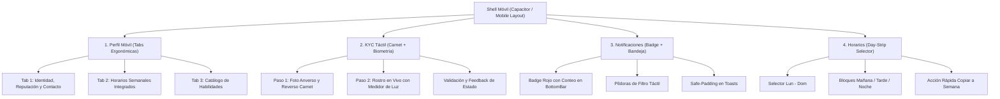

# Plan Maestro de Implementación: App Móvil SkillMatch (Capacitor & Mobile Web)
## Prioridades: Perfil de Usuario, KYC Táctil, Notificaciones y Gestión de Horarios

---

## 1. Visión y Objetivos

El objetivo de esta iniciativa es transformar la experiencia móvil de **SkillMatch** (tanto en navegadores móviles como empaquetada nativamente en Android e iOS mediante **Capacitor 8**), optimizando los cuatro flujos troncales solicitados:

1. **Perfil de Usuario Móvil:** Adaptación ergonómica al formato vertical táctil de una sola columna (*thumb-zone*), organizando la información mediante pestañas fluidas.
2. **KYC / Verificación de Identidad con Carnet y Biometría:** Reemplazo del modal de escritorio por un flujo táctil guiado a pantalla completa (*Mobile Sheet/Drawer*), con soporte de cámara frontal y captura asistida de ambas caras del documento (anverso/reverso).
3. **Notificaciones en Tiempo Real:** Bandeja móvil optimizada, badge numérico en tiempo real sobre la barra inferior (`MobileBottomBar`), y soporte de WebSocket/Push.
4. **Horarios y Disponibilidad Móvil:** Sustitución de la matriz de escritorio de 336 casillas por un selector de días horizontal con bloques horarios táctiles y acciones rápidas (*presets*).
5. **Shell y Empaquetado Capacitor:** Manejo de *Safe Area Insets* (notch y barra de gestos), permisos nativos en Android y scripts de sincronización.

---

## 2. Diagnóstico del Estado Actual vs. Requisitos Móviles

| Módulo | Estado Actual (Web Desktop) | Desafío en Pantallas Móviles (< 768px) | Solución Propuesta (Mobile-First) |
| :--- | :--- | :--- | :--- |
| **Perfil** | Split de dos columnas (`xl:col-span-4` y `xl:col-span-8`). | Scroll vertical interminable; mezcla configuración, horarios y biografía en una sola tira. | **Tabs Táctiles Móviles:** Pestaña 1 (*Identidad & KYC*), Pestaña 2 (*Horarios*), Pestaña 3 (*Habilidades*). |
| **KYC** | `<DialogContent className="max-w-3xl">` en ventana flotante. | Desborde en pantallas de 360-400px; controles de captura pequeños. | **Sheet Full-Screen:** Diálogo táctil paso a paso con marco rectangular para carnet y óvalo facial para biometría en vivo. |
| **Notificaciones** | Página `/notifications` y campana en header. | El ícono de "Avisos" en la barra inferior no muestra cuántas notificaciones no leídas existen; toasts tapan la barra inferior. | **Badge Numérico Reactivo** en `MobileBottomBar`, toasts reposicionados con padding seguro y filtros por píldoras deslizables. |
| **Horarios** | Tabla matricial de 48 filas de media hora $\times$ 7 días (336 casillas). | Imposible de tocar con precisión; requiere incómodo scroll horizontal y vertical. | **Selector Horizontal de Días** con lista vertical de bloques activables por toque y botones de copia masiva (*presets*). |
| **Capacitor Shell** | Configuración básica de Android/iOS existente. | Riesgo de solapamiento con el notch superior o la barra de gestos inferior de Android. | **Safe Area Insets CSS** (`env(safe-area-inset-*)`) y configuración de StatusBar temática. |

---

## 3. Desglose Detallado de Implementación



---

### Módulo 1: Perfil de Usuario Móvil Ergonómico (`/app/profile`)

1. **Encabezado Compacto Móvil:**
   - Avatar táctil con indicador de estado (CI Verificado ✓, Nivel de Confianza, Reputación).
   - Botón de edición rápida con formulario adaptado a modales móviles.
2. **Navegación por Pestañas Táctiles (`Tabs` de Shadcn):**
   - **Pestaña 1: Mi Identidad & KYC:**
     - Tarjeta de presentación, biografía, redes sociales (GitHub, LinkedIn, Portafolio) y modalidad (Virtual, Presencial con radio en km).
     - **Tarjeta de Estado KYC:** Muestra claramente si la cuenta está *Verificada*, *Pendiente*, o *Rechazada* con botón de acción destacado: *"Verificar con Carnet (CI/DNI)"*.
   - **Pestaña 2: Mi Agenda & Horarios:**
     - Integración directa del selector móvil de disponibilidad sin salir de la vista.
   - **Pestaña 3: Mis Habilidades:**
     - Listado de habilidades para enseñar (con nivel verificado) y habilidades que desea aprender.

---

### Módulo 2: KYC Móvil Táctil (Carnet CI/DNI + Biometría en Vivo)

1. **Experiencia de Pantalla Completa (*Full-Screen Sheet*):**
   - En pantallas móviles (`< md`), el modal de verificación se abre cubriendo la pantalla para dar máxima visibilidad a la cámara.
2. **Paso 1: Captura de Documento Oficial (CI / DNI):**
   - Botones táctiles de gran tamaño para Anverso y Reverso:
     - *"Tomar foto con la cámara"* (usando `<input type="file" accept="image/*" capture="environment">` o Capacitor Camera).
     - *"Seleccionar de la galería"*.
   - Recuadro guía en pantalla con esquinas delimitadas para encuadrar el documento.
   - Compresión y recorte automático en el cliente antes de convertir a Base64.
3. **Paso 2: Captura Biométrica Facial en Vivo:**
   - Inicialización automática de la cámara frontal (`facingMode: "user"`).
   - Máscara ovalada traslúcida que guía al usuario para posicionar su rostro en el centro.
   - Medidor continuo de iluminación en barra de progreso con feedback visual: *Baja* (rojo), *Aceptable* (amarillo), *Óptima* (verde esmeralda).
4. **Paso 3: Verificación y Respuestas:**
   - Envío a `POST /api/users/me/identity/verify`.
   - Feedback inmediato: si es exitoso, actualiza el perfil reactivamente y muestra la insignia *CI Verificado ✓*. Si hay rechazo, muestra el motivo claro y permite reintentar en un solo toque.

---

### Módulo 3: Notificaciones en Móvil

1. **Badge en Tiempo Real en `MobileBottomBar`:**
   - Suscripción al store `useNotificationStore((s) => s.unreadTotal)`.
   - Sobre el ícono de **Avisos** (`Bell`), si `unreadTotal > 0`, se muestra una pastilla roja redondeada con el número exacto (ej. `3` o `9+`).
2. **Bandeja de Notificaciones Móvil (`/notifications`):**
   - Barra superior de filtros horizontales táctiles (píldoras deslizables): *Todas*, *Intercambios*, *Puntos (SkillPoints)*, *Sistema*.
   - Botón superior derecho: *"Marcar todas como leídas"*.
   - Tarjetas con espaciado táctil mínimo de 48px para facilitar el toque.
3. **Ajuste de Toasts Móviles (Sonner):**
   - Ajustar el contenedor de Sonner en mobile con `bottom-[64px]` para evitar que las alertas floten encima de la barra de navegación inferior.

---

### Módulo 4: Horarios y Disponibilidad Móvil (Day-Strip Selector)

1. **Selector Horizontal de Días (*Day-by-Day Carousel*):**
   - 7 botones circulares o píldoras táctiles: `Lun`, `Mar`, `Mié`, `Jue`, `Vie`, `Sáb`, `Dom`.
   - El día seleccionado se resalta con el verde esmeralda institucional (`bg-primary text-primary-foreground`).
   - Muestra un punto o mini-badge si el día ya cuenta con horarios configurados.
2. **Listado Vertical de Horas del Día Seleccionado:**
   - Agrupación intuitiva por franjas:
     - **Mañana:** 07:00 a 12:00
     - **Tarde:** 12:00 a 18:00
     - **Noche:** 18:00 a 23:00
   - Cada bloque de 30 minutos se activa o desactiva con un interruptor (`Switch`) o chip táctil fácil de pulsar con el pulgar.
3. **Acciones Rápidas Móviles (*Presets*):**
   - Botón *"Jornada Laboral (09:00 - 18:00)"*: Activa automáticamente ese rango.
   - Botón *"Copiar a toda la semana"*: Replica la configuración del día actual a los demás días hábiles.
   - Botón *"Limpiar día"*: Deja el día libre en un solo toque.
4. **Sincronización:**
   - Persistencia automática contra `PUT /api/users/me/availability` con mensaje de éxito mediante toast.

---

### Módulo 5: Capacitor Mobile Shell & Soporte Android

1. **Gestión de Safe Area Insets:**
   - Configuración en `index.html` con `<meta name="viewport" content="width=device-width, initial-scale=1.0, viewport-fit=cover" />`.
   - Soporte en Tailwind: `pt-[env(safe-area-inset-top)]` para notch y `pb-[calc(54px+env(safe-area-inset-bottom))]` para evitar que la barra de navegación se pegue a la barra de gestos de Android.
2. **StatusBar y Background Nativo:**
   - Sincronización del color de la barra de estado con el tema de la aplicación.
3. **Pruebas y Build Nativo:**
   - Comando de compilación y empaquetado:
     ```bash
     npm run build
     npx cap sync android
     ```
   - Verificación de permisos en `AndroidManifest.xml` (`CAMERA`, `INTERNET`, `RECORD_AUDIO`).

---

## 4. Fases de Ejecución Propuestas

| Fase | Tareas Principales | Entregables |
| :--- | :--- | :--- |
| **Fase 1: Shell & Notificaciones** | - Badge numérico en `MobileBottomBar`<br>- Safe-area padding y ajuste de Toasts en móvil<br>- Filtros táctiles en `/notifications` | `MobileBottomBar` con badge reactivo y avisos 100% táctiles. |
| **Fase 2: Perfil Móvil con Tabs** | - Reorganización de `profile-page.tsx` en Pestañas móviles<br>- Encabezado compacto y modal de edición móvil | Perfil táctil sin scroll kilométrico. |
| **Fase 3: KYC Táctil a Pantalla Completa** | - Adaptación de `BiometricEnrollmentCard` como Sheet full-screen<br>- Guía visual de carnet y captura facial táctil<br>- Manejo de permisos nativos de cámara | Verificación de carnet y biometría 100% usable en móvil. |
| **Fase 4: Horarios Móviles (Day-Strip)** | - Componente de disponibilidad móvil por día (`Lun-Dom`)<br>- Toggles táctiles de horas y botones de presets rápidos<br>- Sincronización con el backend | Configuración de disponibilidad sin la matriz pesada de escritorio. |
| **Fase 5: Sincronización Capacitor & QA** | - `npx cap sync android`<br>- Pruebas unitarias de componentes móviles en Vitest<br>- Verificación de responsive en 360px, 390px y 412px | Build listo para probar en dispositivo real o emulador. |
